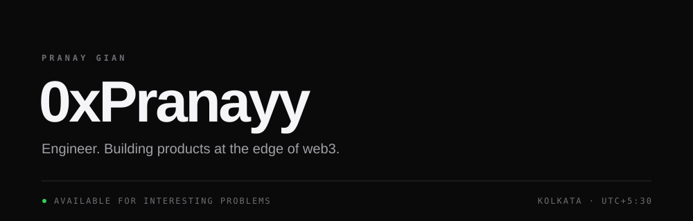
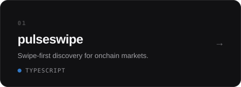
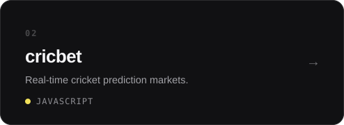
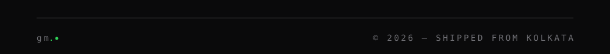

&nbsp;&nbsp;I care about products that feel inevitable — fast, quiet, and obvious in hindsight.
&nbsp;&nbsp;Currently building consumer experiences on top of crypto rails.

 

#### &nbsp;&nbsp;Selected work

&nbsp;&nbsp;
&nbsp;

#### &nbsp;&nbsp;Activity

&nbsp;&nbsp;
&nbsp;

#### &nbsp;&nbsp;Toolkit

&nbsp;&nbsp;`TypeScript`&nbsp; `React`&nbsp; `Next.js`&nbsp; `Node`&nbsp; `Solidity`&nbsp; `PostgreSQL`

#### &nbsp;&nbsp;Elsewhere

&nbsp;&nbsp;[Website](https://0xpranayy.xyz) &nbsp;·&nbsp; [Writing](https://mirror.xyz/0xpranayy.eth) &nbsp;·&nbsp; [X](https://x.com/pronoy) &nbsp;·&nbsp; [Farcaster](http://farcaster.xyz/pranayagian)

 

