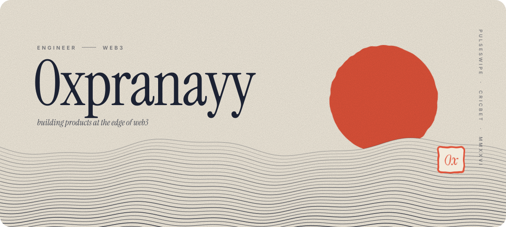
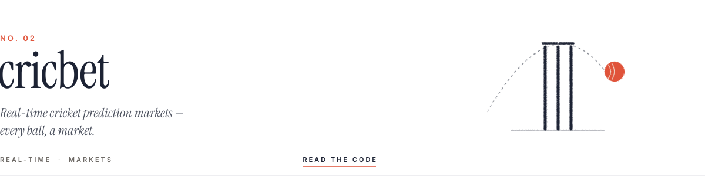

<picture>
  <source media="(prefers-color-scheme: dark)" srcset="./assets/header-dark.svg">
  
</picture>

  

<picture>
  <source media="(prefers-color-scheme: dark)" srcset="./assets/intro-dark.svg">
  
</picture>

 

<picture>
  <source media="(prefers-color-scheme: dark)" srcset="./assets/s-work-dark.svg">
  
</picture>

<a href="https://github.com/0xpranayyy/pulseswipe">
<picture>
  <source media="(prefers-color-scheme: dark)" srcset="./assets/pulseswipe-dark.svg">
  
</picture>
</a>
<a href="https://github.com/0xpranayyy/cricbet">
<picture>
  <source media="(prefers-color-scheme: dark)" srcset="./assets/cricbet-dark.svg">
  
</picture>
</a>

  

<picture>
  <source media="(prefers-color-scheme: dark)" srcset="./assets/s-tools-dark.svg">
  
</picture>

<picture>
  <source media="(prefers-color-scheme: dark)" srcset="./assets/tools-dark.svg">
  
</picture>

  

<picture>
  <source media="(prefers-color-scheme: dark)" srcset="./assets/footer-dark.svg">
  
</picture>

  
    <a href="https://0xpranayy.xyz">website</a> &nbsp;·&nbsp;
    <a href="https://mirror.xyz/0xpranayy.eth">writing</a> &nbsp;·&nbsp;
    <a href="https://x.com/pronoy">x</a> &nbsp;·&nbsp;
    <a href="http://farcaster.xyz/pranayagian">farcaster</a>
  

